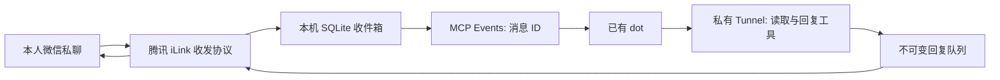

# WeChat Dot Bridge

把微信插件的本人私聊消息接到**已有的 OpenAI dot**：微信来信保存到本机队列，通过 MCP Events 通知 dot；dot 读取来信、调用回复工具，桥接把回复发回该消息所属的微信对话。

桥接使用 Python 3.11+、SQLite、cryptography 和 Pillow。它不运行模型、不调用模型 API、不启动 Codex CLI，也不创建替代 dot 的助手。dot / Work 和相关 OpenAI 产品仍受各自用量与费用规则约束。

**当前版本：0.1.0，实验性 / Early Access，支持 Linux 和 systemd 用户服务、本人单账号私聊。** 文字、输入提示、图片描述与原图回传、文件回传、语音接收与转写、旧图引用回复、视频回传、进度加长文及生成 TXT 文件已由本人确认。接入能力、账号权限和微信实际行为需要在你自己的环境验证；历史结果不代表其他部署已通过。



## 范围和依赖

- 本人单账号、私聊、完整文字消息，同一来信可提交多条进度、分段及完成回复。
- 微信协议与绑定格式依据 [Tencent/openclaw-weixin](https://github.com/Tencent/openclaw-weixin)；无需安装或运行 OpenClaw。
- 私有连接使用官方 [openai/tunnel-client](https://github.com/openai/tunnel-client/releases/latest)，不开放本机公网 MCP 端口。
- 事件依据 [OpenAI MCP Events](https://developers.openai.com/plugins/build/mcp-events)，支持 `2026-07-28` discovery、验证、订阅刷新和取消。
- `cc-connect` 和 `dots-wechat-bridge` 只作为可行性调查参考，不是运行依赖；本目录没有复制它们的实现。
- 支持图片、文件、视频、语音转写及 AMR/SILK 回传、引用内容、长文分段、分块上传；详细边界见 [能力对照](docs/CAPABILITIES.md)。
- 不支持群聊、多用户、无来信无限制主动发送或跨账号历史迁移。

本地安装脚本面向 Linux 和 systemd 用户服务。先确认 Python 版本；在启动包装器使用的 Python 环境中安装依赖，或先创建专用 venv，再使用该环境执行安装脚本。

```bash
python3 --version
python3 -m pip install -e .
python3 -m unittest discover -s tests -v
```

## 准备私人访问条件

你需要已有 dot、创建私人开发者插件的权限、可使用的 Secure MCP Tunnel，以及 Tunnel 运行密钥。Tunnel 的管理 / 使用权限与 ChatGPT 开发者模式权限分开，详见 [官方 Tunnel 指南](https://developers.openai.com/api/docs/guides/secure-mcp-tunnels)。

只把该 Tunnel 和插件提供给自己。**此服务器信任 Tunnel 的访问边界；没有为共享组织的多个调用者建立独立用户身份。** 不要把插件分享给组织、团队或其他账号。无法确认访问范围时，保持未启动状态。

从官方发行包下载并保留 `tunnel-client` 及其随附许可。安装前按官方入口确认你的 Tunnel identity；不要自行拼接 `server_url`。本项目不提供公共 MCP 地址。

## 本地安装

以下变量只代表你自己的专用目录和已安装程序。先把 `WDB_TUNNEL_BIN` 与 `WDB_TUNNEL_ID` 设置为官方程序位置、你在控制台取得的 identity；示例不包含任何真实 identity 或密钥。

```bash
WDB_SOURCE="$PWD"
WDB_CONFIG="$HOME/.config/wechat-dot-bridge"
WDB_STATE="$HOME/.local/share/wechat-dot-bridge"
WDB_KEY_FILE="$WDB_CONFIG/tunnel-runtime-key"
```

已有合适的私人 Tunnel 运行密钥文件时，直接把 `WDB_KEY_FILE` 指向该文件，保留原文件。没有文件时，在自己的交互式终端隐藏输入保存：

```bash
python3 scripts/save_runtime_key.py --path "$WDB_KEY_FILE"
```

不要把密钥放入命令参数、管道、聊天、截图或 Git。保存脚本拒绝覆盖已有文件和非交互输入；专用目录为 `0700`、文件为 `0600`。

生成源码启动包装器、私人配置和 systemd 用户服务：

```bash
python3 scripts/install_local.py \
  --source-dir "$WDB_SOURCE" \
  --config-dir "$WDB_CONFIG" \
  --state-dir "$WDB_STATE" \
  --tunnel-bin "$WDB_TUNNEL_BIN" \
  --tunnel-id "$WDB_TUNNEL_ID" \
  --key-file "$WDB_KEY_FILE"
```

默认包装器安装到 `~/.local/bin/wechat-dot-bridge`，用户服务到 `~/.config/systemd/user/wechat-dot-bridge.service`。可用 `--bin-dir`、`--unit-dir` 指定其他位置。已有共享程序 / unit 目录可以保留安全的 `0755` 权限，安装器不修改共享目录权限；专用配置与状态目录仍必须为 `0700`，私人文件为 `0600`。脚本不覆盖现有目标，**不会 enable 或 start 服务**。选项 `--proxy http://127.0.0.1:PORT` 仅用于已存在的本机 Tunnel 控制面代理；Events 回调的代理通过下面的独立配置设置，微信收发仍直连经过目标校验的腾讯 HTTPS。

`bridge.json` 中的 `callback_hosts` 初始为空，因此不会向未经批准的回调发送数据。回调的精确域名配置见 [dot 接入说明](docs/DOT_SETUP.md)。配置文件、Tunnel profile 和状态目录都不应加入版本库。

Events 默认使用本机 DNS 和直接 HTTPS；需要经本人管理的本机代理出站，或本机 DNS 对回调主机返回异常地址时，在私人 `bridge.json` 中配置 `callback_proxy` 与 `callback_dns`。下面仅展示相关字段，`PORT` 应替换为现有代理的实际端口：

```json
{
  "callback_hosts": ["connectors.api.openai.com"],
  "callback_proxy": "http://127.0.0.1:PORT",
  "callback_dns": "google"
}
```

只配置已从本人 dot 核验的精确回调主机；官方 MCP Events 文档没有公布上述主机白名单。`callback_proxy` 仅接受 `http://127.0.0.1:端口`；`callback_dns` 支持 `system`（默认）和 `google`，后者固定连接 `8.8.8.8:443` 并以 `dns.google` 核验 TLS。桥接先检查回调 allowlist，再解析并校验公网 IP，代理 `CONNECT` 使用该 IP，回调 TLS 和 HTTP `Host` 保留原 hostname；不继承环境代理，不改变系统 DNS 或代理配置。

Google DoH 仅收到回调主机 DNS 查询，回调路径、签名 secret 和消息不会交给 DNS 服务。本机代理转发 HTTPS 并可观察连接元数据。配置后重启服务，再由原 dot 重新订阅并确认 challenge 验证成功；网络验证失败时不会向回调投递事件。详见 [安全说明](docs/SECURITY.md)。

## 保留或新建微信绑定

微信绑定、OpenClaw 历史和 dot 会话是三个不同层，**不会自动迁移历史**。

有有效原绑定时，优先导入你明确选择的官方 OpenClaw account JSON，或一个可唯一选中的 cc-connect 微信配置：

```bash
"$HOME/.local/bin/wechat-dot-bridge" --config "$WDB_CONFIG/bridge.json" \
  import-binding /private/path/to/selected-account.json
```

需要区分 cc-connect 配置中的多个绑定时传入 `--account-id`。导入只读取所选来源，不扫描认证目录、不改写来源；导入后默认停止接收。已经建立的 bridge 不允许改换 account / owner。

**任何收信验证或切换前，都要确认原 OpenClaw / cc-connect 接收服务已停止。** 每个绑定只能有一个收信服务。桥接的本机进程锁不能阻止其他程序或另一台机器消费同一绑定。

如果旧绑定不能提供可导入凭据，必须使用新二维码登录，不能保证仍是原来的微信机器人或原来的对话。在服务未运行时执行：

```bash
"$HOME/.local/bin/wechat-dot-bridge" --config "$WDB_CONFIG/bridge.json" login-start
```

命令返回安全的状态与 `qr_state_file` 位置；二维码内容只保存在该专用目录内的私人登录状态文件。可选的 setup 工具在本地生成私人 PNG，不下载远程图片、不打印二维码链接。它使用独立 venv 中的 `qrcode==8.2`；此依赖不参与 bridge 的正常运行：

```bash
WDB_SETUP="$HOME/.local/share/wechat-dot-bridge-setup"
python3 -m venv "$WDB_SETUP"
"$WDB_SETUP/bin/python" -m pip install qrcode==8.2
"$WDB_SETUP/bin/python" scripts/render_login_qr.py \
  --state-dir "$WDB_STATE" \
  --output "$WDB_STATE/weixin-login-qr.png"
```

渲染脚本只接受状态目录内的新 PNG 文件名，拒绝覆盖。通过自己可信的本机 / SSH 文件访问方式展示该图片，再在手机微信确认登录；无头服务器无需安装图形桌面。不要把状态文件或二维码交给公共二维码网站、聊天或日志收集器。随后执行一次有时间上限的状态查询；仍为等待状态时再查询：

```bash
"$HOME/.local/bin/wechat-dot-bridge" --config "$WDB_CONFIG/bridge.json" login-poll
```

若返回 `requires_phone_verification: true`，使用隐藏输入，不把验证码放入参数：

```bash
"$HOME/.local/bin/wechat-dot-bridge" --config "$WDB_CONFIG/bridge.json" \
  login-poll --verification-code
```

`confirmed` 后凭据写入私有 SQLite，接收仍保持关闭；二维码过期可重新 `login-start`。`already_bound` 不等于本机已有可用凭据，不能据此启动接收。

确认运行密钥文件可安全读取，且没有第二个接收者后，再开启绑定并启动 Tunnel 服务：

```bash
python3 scripts/check_runtime.py \
  --key-file "$WDB_KEY_FILE" --state-dir "$WDB_STATE" \
  --config "$WDB_CONFIG/bridge.json" --key-only
"$HOME/.local/bin/wechat-dot-bridge" --config "$WDB_CONFIG/bridge.json" \
  resume --confirm-single-consumer
systemctl --user daemon-reload
systemctl --user start wechat-dot-bridge.service
```

服务启动后查询本机健康和安全状态：

```bash
python3 scripts/check_runtime.py \
  --key-file "$WDB_KEY_FILE" --state-dir "$WDB_STATE" \
  --config "$WDB_CONFIG/bridge.json"
```

预期 `key_ready`、`tunnel_healthy` 和 `tunnel_ready` 为 `true`。Tunnel 尚未启动时完整检查返回非零属正常；启动前只使用 `--key-only`。若安装时更换包装器位置，向完整检查追加 `--command /your/wrapper/path`。

是否设置开机持续运行由你决定；需要时执行 `systemctl --user enable wechat-dot-bridge.service`。用户退出后的运行策略取决于主机的 systemd 用户管理配置，安装器不会修改它。

## 接到已有 dot 并验收

按 [完整 dot 设置步骤](docs/DOT_SETUP.md) 在插件页面创建**仅自己使用**的开发者插件，选择 **Tunnel**，添加到你原有 dot，再订阅 `weixin.message`。

| 工具 | 用途 |
| --- | --- |
| `get_weixin_status` | 查看安全状态、队列和订阅错误 |
| `read_weixin_message` | 读取本人来信、引用和附件；就绪图片直接返回可视预览 |
| `read_weixin_attachment` | 读取图片预览、文件分块与文本文件内容 |
| `stage_weixin_attachment` | 私有暂存新附件，支持分块上传 |
| `import_weixin_attachment` | 从明确提供的公开 HTTPS 地址导入附件 |
| `reply_weixin_attachment` | 将收到或暂存的附件回传同一对话 |
| `reply_weixin_message` | 为已有来信提交回复，支持多次追加 |
| `report_weixin_progress` | 续期或结束处理进度与输入提示，不发送消息 |
| `retry_weixin_operation` | 重试明确失败的发送或附件下载，保留已接受部分 |
| `get_weixin_send_status` | 查询 API 接受、失败或不确定状态 |
| `list_pending_weixin_messages` | 显式恢复尚未提交回复的来信 |

验收只发一条有唯一标记的文字。确认现有 dot 收到事件、读取同一消息 ID、提交回复，并由你在同一个微信对话看见一次回复。记录状态和时间即可，不要共享消息原文、callback URL、token 或密钥。

当前应发现表中的 **11 个工具**及 `weixin.message` 事件。按 [当前部署验收清单](docs/ACCEPTANCE.md)逐项记录自己的结果；[历史真人验收记录](docs/REAL_VALIDATION.md)保留此前部署证据，其中旧版五 / 八工具是当时的数量。

`accepted` 仅代表微信 API 接受请求，**不等于已经投递或已读**。POST 后失联会保留 `uncertain`，系统不盲目重发。同一来信可以追加多条不同回复；相同正文默认幂等，独立 `reply_key` 可区分有意重复的回复。长文分段状态会持久保存，可查询 `parts_total` 和 `parts_accepted`。详细失败与恢复边界见 [安全说明](docs/SECURITY.md) 和 [dot 设置说明](docs/DOT_SETUP.md)。

## 停止与回滚

修改绑定、登录状态或启停标志前先停止运行中的服务：

```bash
systemctl --user stop wechat-dot-bridge.service
"$HOME/.local/bin/wechat-dot-bridge" --config "$WDB_CONFIG/bridge.json" pause
```

需要撤销常驻时运行 `systemctl --user disable wechat-dot-bridge.service`。保留状态数据库和私有文件以便排查与回滚。恢复旧微信接收者前确认本桥接完全停止；原配置从未被导入流程覆盖。撤销 dot 订阅、移除私人插件或撤销 Tunnel 使用权限后，检查不再产生新发送。

## 许可

原创桥接实现使用 [MIT](LICENSE)。官方腾讯协议参考的版权许可保存在 [licenses](licenses/Tencent-openclaw-weixin-MIT.txt)，来源说明见 [NOTICE.txt](NOTICE.txt)。官方 Tunnel client 单独安装并保留自己的许可。本项目与 OpenAI、腾讯无隶属或背书关系。

媒体 CDN 网络单独支持 `media_proxy`（仅本人本机 `http://127.0.0.1:端口`）及 `media_dns`（system / google），默认直连及系统 DNS。仅在本机 DNS 或直连不可用时配置；同样保留精确腾讯主机、公共 IP 固定连接、TLS 域名核验和无重定向。DoH 只接收 CDN 主机名，不接收媒体 URL 参数或 AES 密钥；本机代理转发端到端 HTTPS。它不修改全局代理、微信 API 或 Events 回调设置。

## 通道修复和可选编解码器

当前 MCP 提供十一个工具，新增失败恢复与处理进度。可用 `bash scripts/install-codecs.sh` 安装可选本地音频转换（Node 24+、npm、uv）；不调用模型。完整能力、预算、真人验证边界和回滚说明见 [通道修复对照](docs/CHANNEL_REPAIR.md)。


## 安装、维护与验收

- [干净环境安装与发布检查](docs/INSTALL.md)
- [故障诊断、管理命令、升级与备份恢复](docs/OPERATIONS.md)
- [真人验收步骤及待确认边界](docs/ACCEPTANCE.md)
- [贡献指南与本地发布检查](CONTRIBUTING.md)
- [版本与升级记录](CHANGELOG.md)
- [私密漏洞报告](SECURITY.md)

已支持 public HTTPS 文件导入和自动媒体类型识别。服务器不会把 dot 的 sandbox 文件路径当成本机路径。故障提示明确标为“桥接状态”，不运行额外模型，不会将原消息标记为处理完成。
