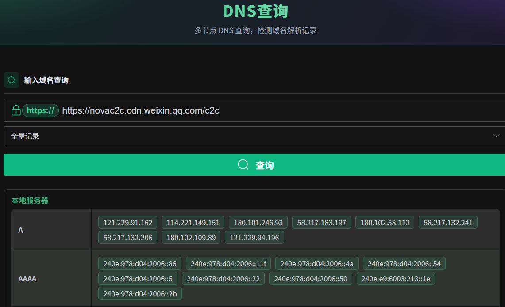

# 系统 DNS 双栈响应导致媒体上传失败的脱敏日志

## 实际故障的最小记录

以下摘要只记录诊断所需字段。截图和下方文本保留了公共媒体 CDN 域名 `novac2c.cdn.weixin.qq.com` 在这一次查询中返回的公网地址。



| A 记录（IPv4） | AAAA 记录（IPv6） |
|---|---|
| `121.229.91.162` | `240e:978:d04:2006::86` |
| `114.221.149.151` | `240e:978:d04:2006::11f` |
| `180.101.246.93` | `240e:978:d04:2006::4a` |
| `58.217.183.197` | `240e:978:d04:2006::54` |
| `180.102.58.112` | `240e:978:d04:2006::5` |
| `58.217.132.241` | `240e:978:d04:2006::22` |
| `58.217.132.206` | `240e:978:d04:2006::50` |
| `180.102.109.89` | `240e:e9:6003:213::1e` |
| `121.229.94.196` | `240e:978:d04:2006::2b` |

两列分别按截图顺序列出。共 18 条，超过旧版默认系统 DNS 的 16 条原始记录上限。

```text
system_dns_ipv4_records=9
system_dns_ipv6_records=9
system_dns_total_records=18
system_dns_all_records_public=true
resolver_error=dns_failed
media_error=media_network_failed
reply_parts_before=text:accepted,image:failed
deployment_workaround=encrypted_dns_and_loopback_media_proxy
retry_scope=original_image_part
reply_parts_after=text:accepted,image:accepted
```

原图片的恢复结果来自部署配置调整。下节专门记录上游源码补丁的离线验证。

## 离线补丁验证

基线为公开上游提交 `7a788aa`。使用锁文件依赖、合成双栈记录以及模拟传输运行媒体入口。表中“测试传输”仅统计离线传输调用。

| 版本 | 原始记录 | 结果 | 交给传输的候选数 | 测试传输次数 | 实际网络连接 |
|---|---:|---|---:|---:|---:|
| 基线 | 16 | 成功 | 16 | 1 | 0 |
| 基线 | 18 | `media_network_failed` | 0 | 0 | 0 |
| 补丁 | 16 | 成功 | 16 | 1 | 0 |
| 补丁 | 18 | 成功 | 16 | 1 | 0 |

18 条输入由 9 条 IPv4 和 9 条 IPv6 组成。离线用例使用合成附件，只检查媒体上传能否进入传输层。

要对照基线行为，可在父提交上只应用本次新增的测试，再与补丁版本运行同一条命令。

```bash
PYTHONPATH=tests uv run --locked --all-extras python -m unittest test_dns_transport.SharedDNSTransportTests.test_large_system_dns_answer_reaches_media_upload
```

```text
baseline_regression_reproduced=true
large_dual_stack_answer=pass
duplicates_preserve_candidate_budget=pass
invalid_tail_rejected=pass
system_input_budget_256_257=pass
dns_test_module=11_passed_0_failed_0_skipped
ruff=pass
```

## Linux 完整回归

两个独立检出使用相同的补丁和锁定依赖。测试运行时隔离外部网络。

| Python | 完整 unittest | 失败 / 错误 / 跳过 | 发布检查 | 隐私扫描命中 |
|---|---:|---|---|---:|
| 3.11.18 | 386 | 0 / 0 / 0 | 9 / 9 通过 | 0 |
| 3.14.10 | 386 | 0 / 0 / 0 | 9 / 9 通过 | 0 |

发布项目依次为锁文件、Ruff、语法、单元测试、升级演练、秘密扫描、差异格式、源码包与 wheel，以及安装 wheel 后的验收。
